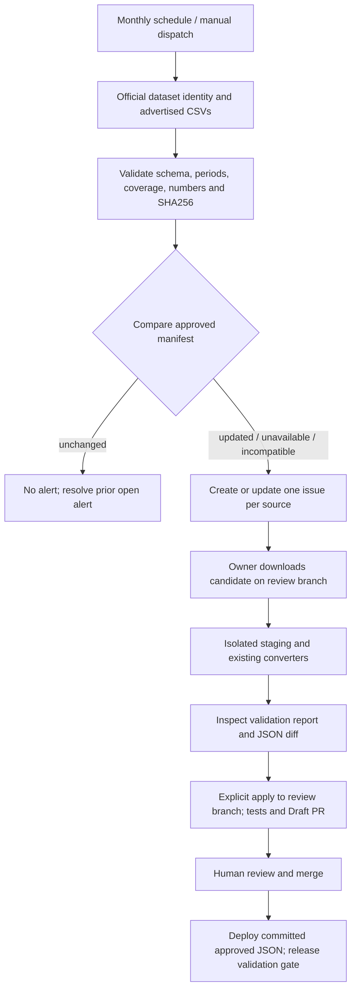

# Quarterly monitoring and reviewed updates (Issue 9)

Detection is automated; publication remains a reviewed Git change. No backend, database, live browser acquisition, new dependency or chart redesign is introduced.



## Sources and current coverage

The source identities below were checked on 2026-10-29 against official Taipei pages and advertised downloads. The residential-rent dataset is **029c6d0d**, not **53e5ee8d** (the latter is quarterly market analysis). The README link is corrected in both languages.

| Source | Approved coverage / records | Live finding on 2026-10-29 |
|---|---|---|
| [Residential Price Quarterly Index](https://data.taipei/dataset/detail?id=954911b5-896d-4ae1-9ebe-87c4ba8a191e) | 2012-Q3–2025-Q4; 864 rows; 16 categories including 12 districts | 2026-Q1, 880 rows; updated |
| [Residential Rent Index](https://data.taipei/dataset/detail?id=029c6d0d-c880-4de7-b2fb-9e56669a6f20) | 2018-Q3–2025-Q4; 90 rows; 3 categories | 2026-Q1, 93 rows; updated |
| [Commercial Office Rent Index](https://data.taipei/dataset/detail?id=8a3d1df7-9169-4dd0-ae0a-949d970e9bb3) | 2014-Q2–2025-Q4; 94 rows; 2 categories | 2026-Q1, 96 rows; updated |
| [Quarterly Market Analysis](https://data.taipei/dataset/detail?id=53e5ee8d-9a90-42bc-9874-3a8747ae6afa) | 2025-Q2; 13 source rows including citywide; 12 generated district records | 2025-Q2, unchanged |

Raw approved snapshots remain under `data/raw/<dataset>/`. `data/quarterly-approved.json` pins their exact SHA256, official source identity, expected columns, categories and periods. Generated outputs remain under `public/data/`. No live findings were applied in this PR. See [actual monitor evidence](evidence/quarterly-monitor.json) and [isolated candidate conversion evidence](evidence/quarterly-staging.json) for hashes and validation details.

## Monitoring

`.github/workflows/quarterly-data-monitor.yml` runs on the fifth day of each month at 02:23 UTC (10:23 Taipei), and supports `workflow_dispatch`. It has `contents: read` and `issues: write` only. Concurrency serializes runs. There is no data commit, deployment, merge or production write step.

```bash
npm run data:monitor:quarterly
```

This local command writes only `.cache/quarterly-monitor/report.json`. The Action adds `--notify` with its GitHub token. Identity/agency, availability, advertised resource URL, CSV schema, unique quarter/category identities, complete district/category coverage, contiguous periods, record counts, strict numeric cells and SHA256 are checked. Only HTTPS resources on `data.taipei` are accepted, including every redirect. UTF-8-SIG and Big5 are supported. The historical `宅價格季指數類別` typo is the sole explicit price-column alias; normalized punctuation aliases match the existing converter.

Index downloads are cumulative: detect changed bytes and identify both new periods and revised overlapping records. Market downloads are one file per quarter: discover the period from the official resource title, inspect retained periods and newer downloads, and compare approved raw hashes. Older market files outside retained coverage are excluded, not newly imported or treated as missing history.

Unchanged findings create no issue. Each source uses a hidden stable marker, searches all issue pages including closed issues, and stores a finding fingerprint in the issue body. Identical findings cause no API mutation, comment or reopening. A changed finding updates/reopens the existing issue. An unchanged approved source closes a prior open alert. Do not remove the marker or edit the fingerprint. Findings are also retained as an Actions artifact. GitHub issue-subscription preferences control delivery to the owner.

Example alert (abbreviated; the real body includes full hashes):

```text
[Quarterly data] 臺北市住宅價格季指數: updated
Source: https://data.taipei/dataset/detail?id=954911b5-896d-4ae1-9ebe-87c4ba8a191e
Latest quarter: 2026-Q1; previous approved quarter: 2025-Q4
SHA256: <deterministic aggregate of period:download-hash entries>
Previous approved SHA256: <full approved raw hash>
Validation: schema, periods, counts, coverage, numeric values and SHA256 validated.
Resource SHA256: 2026-Q1=5156f45baef441aef45c2e357da6e7aaf3514c26ade6241282ac1fb28084d298 (880 source rows)
New periods: 2026-Q1; revised records: 0
Detection only. Production data was not changed.
```

If official HTML/download layout, resource identity or schema changes, monitoring reports incompatible/unavailable rather than guessing a download or using cached files. Fix and re-audit the specific source before importing. Transient source failures retain the snapshot. GitHub API failures fail the Action for operator attention; the next run safely retries. The first real scheduled notification cannot occur until this workflow is reviewed and merged to the default branch; local testing did not send live issues.

## Repeatable update procedure

Use Node 22 and a fresh review branch. Keep unrelated edits out of this branch.

```bash
git switch -c codex/quarterly-reviewed-update
npm ci
npm run data:monitor:quarterly
npm run data:fetch:residential-price-quarterly
# Other targeted downloads:
# npm run data:fetch:rent-index
# npm run data:fetch:commercial-rent
# npm run data:fetch:quarterly-market
```

The old fetch commands now download into ignored `.cache/quarterly-downloads/<dataset>/<SHA256>.csv` and a `.csv.json` sidecar. They never overwrite approved raw data or silently reuse existing files. Network failure exits unsuccessfully. The aggregate fetch command no longer acquires market analysis, which has its own explicit command; aggregate offline conversion reads only approved manifest entries for these four sources.

Read the sidecar for the exact official resource URL and hash, then use the source-validated quarter from the monitor. A concrete price candidate found during implementation can be staged as follows (availability may change; always re-download and verify):

```bash
npm run data:stage:quarterly -- --dataset residential-price-quarterly-index --file .cache/quarterly-downloads/residential-price-quarterly-index/5156f45baef441aef45c2e357da6e7aaf3514c26ade6241282ac1fb28084d298.csv --period 2026-Q1 --sha256 5156f45baef441aef45c2e357da6e7aaf3514c26ade6241282ac1fb28084d298 --source-url "https://data.taipei/api/frontstage/tpeod/dataset/resource.download?rid=3210976b-f578-483c-8853-3ceec3796877"
```

Staging validates before conversion, copies retained inputs into a unique ignored `.cache/quarterly-stage-*` directory, and runs the existing targeted converter and summary scripts there. Inspect its `validation.json` and generated `public/data/` diff against the approved files. Staging does not alter approved inputs/outputs. The three real live index candidates passed staging with 0 overlapping revisions and `applied: false`.

For market analysis, CSV cells have no year/quarter. **Also pass `--provenance <download.csv.json>`** from the official download command. Its source URL, raw hash and official resource title must match `--source-url`, `--sha256` and `--period`. Never rename/relabel an older file as a new quarter. Metadata is review evidence, not a cryptographic authority signature: inspect the official page and the sidecar together. If direct acquisition is unavailable, an owner may supply an audited manual CSV plus matching official resource metadata; document the access limitation and preserve the snapshot unless identity/period/hash can be verified.

After reviewing the staged diff, repeat the **same command with `--apply`** to regenerate and copy validated files into the review branch. Existing raw snapshots are retained; new raw filenames include the validated period and complete hash. Approved entries merge by quarter/category, with the later explicitly approved entry winning an overlap; all derived metrics are recalculated using existing functions. Duplicate identities within a source, unknown categories, missing categories/quarters, invalid values or hash mismatches stop the import. An overlapping changed record requires `--allow-revision` after reviewing the official revision; the old raw file remains in history. A revised older retained market quarter may also use that flag. Never change the baseline hash to bypass a validation failure.

```bash
git diff --stat
git diff -- data/quarterly-approved.json public/data
npm test
npm run build
npm run data:audit:urban-renewal-evidence
npm run release:verify
# Review raw input, sidecar, manifest, JSON, and evidence; commit on this branch and open a Draft PR.
```

Price imports regenerate records, summary, latest snapshot and embedded Market Overview metrics. Rent imports regenerate records, summaries and overview fields. Office imports also regenerate category series/premiums. Unrelated overview fields are preserved. Market imports retain historical quarters, regenerate latest-only totals and district comparison, and supply latest-only rows to the existing chart/text presentation. Data Freshness reads dynamic summaries for all four sources. Units, formulas, filters and bilingual chart designs remain intact. No React edit is needed for each quarter.

Validation/conversion failures occur entirely in staging and cannot replace approved files. Apply rolls back every touched path if a write fails, continuing restoration even if one path remains locked; inspect `git diff` after any filesystem error. Use a dedicated branch and keep a backup/clean Git state: a process/OS crash during multi-file application is not an atomic Git transaction. Publication occurs only after human review/merge; do not deploy from the staging directory.

## Deployment and verification limits

Routine deployment now uses committed JSON. It runs no `data:fetch` and no broad `data:convert`. Offline source audits and the existing release validation gate precede artifact upload; failure leaves the previously published Pages artifact intact.

**Existing deployment blocker found on 2026-10-29:** the app references `public/data/rental-housing-service-businesses/records.json`, but that path (and its raw input directory) is absent from the committed snapshot. `npm run release:verify` correctly fails with `Missing application data: rental-housing-service-businesses/records.json`. The similarly named `active-rental-housing-service-providers` dataset is a separate source and must not be silently substituted. This PR does not fetch or fabricate unrelated rental-business data or weaken the gate. A separately reviewed approved snapshot is required before a deployment can pass. This is a deployment prerequisite, not a monitor or converter failure.

Actual verification: baseline 72 tests/build passed; final suite includes synthetic new-quarter conversion for all four sources, latest rankings/series/overview fields, market history/latest selection, schema/coverage/value/date failures, duplicate detection, revisions requiring review, hash mismatches, unchanged/closed-issue deduplication and partial-write rollback. See `progress.md` for final counts and browser results. There is no lint script configured; TypeScript static checking runs as part of `npm run build`. Live source checks are dated evidence and do not imply future availability or fresher production coverage.
