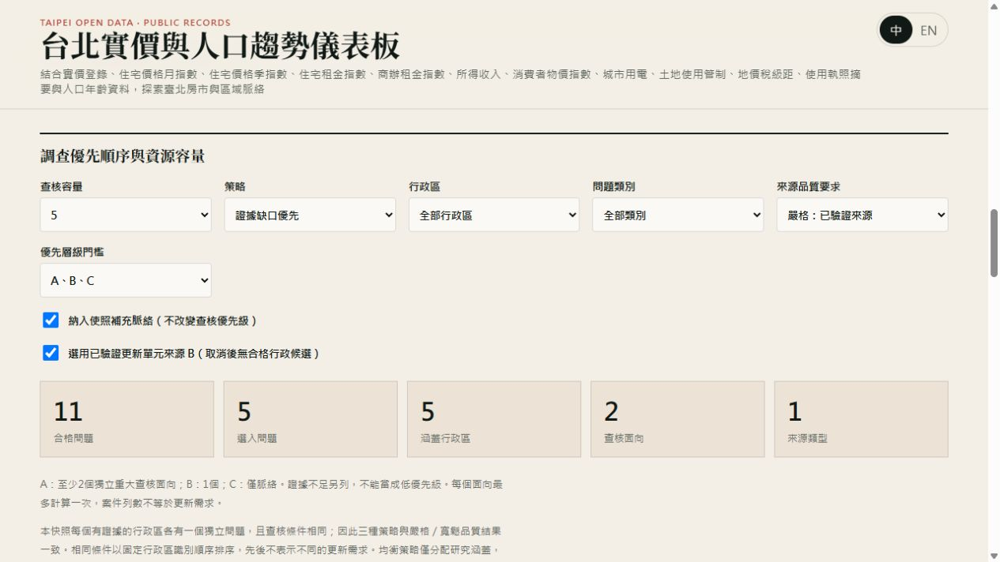
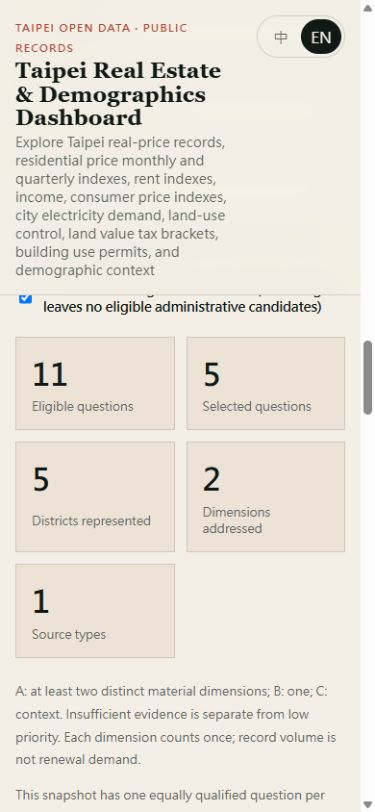
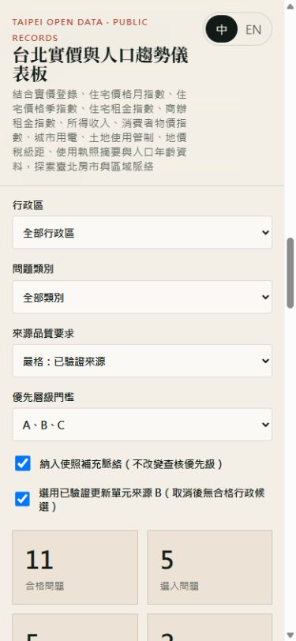

# Urban renewal browser verification — 2026-10-19

Reviewed the local dashboard at `/taipei-real-estate-dashboard/` using the in-app browser and a loopback-only Vite server. The new module is reached through existing searchable navigation. Snapshot: `ure-c81e4ef44e6c9868`. Methodology: `urban-renewal-evidence-review-v1`; configuration: `1.0.0`.

| Interaction | Observed result |
| --- | --- |
| Chinese default and English switch | Localized headings, controls, explanations, exclusions and scenario details |
| Capacity 5 → 10 | 11 eligible; selected/districts 5 → 10; two dimensions and one source type |
| Balanced strategy | Same current result, explicitly disclosed because there is one equally qualified question per district |
| Custom capacity 0 → 3 | 0 shows validation and disables export while preserving last valid result; 3 selects three questions |
| Xinyi filter | Empty shortlist; no invented district aging or zero-case claim |
| Building-age mode | Citywide-only heading, annual stock table, unavailable early age fields and 2012 discrepancy |
| Snapshot failure / retry | Temporarily moved the exact local snapshot file, observed isolated error; restored file and Retry loaded 11 eligible / 5 selected |
| JSON and CSV download | Both downloaded successfully; inspected final JSON preserves current snapshot ID and five selected questions |
| Desktop / mobile 390 × 844 | English and Chinese have document client/scroll widths of 375/375px, with local table scrolling |
| Existing market overview | 998 records remain visible |
| Existing use permits | 8,855 records and 2001–2026 coverage remain visible |
| District comparison | Existing charts and district focus controls remain available |
| Data Status | New evidence snapshot row loaded with designation coverage through 2024-06-05 and separately labelled processing timestamp |
| Urban renewal regulations | Existing 37-row reference module remains accessible |

The first mobile review exposed intrinsic table width expanding the grid. Setting a zero minimum width on the module grid and its children fixed it. The visual verdict after correction was 93/pass against the established dashboard design; no user-supplied reference image existed. Screenshot evidence:

The final production build passed; browser interactions used the local development server at the same GitHub Pages base path. Service-worker publication behavior was separately executed in a VM regression: the snapshot is pre-cached, a newer network snapshot replaces an old cached version, and offline requests return the last valid cached response. This is not a claim of a production deployment or exhaustive assistive-technology/device certification.

Full verification: `npm.cmd test` (63 passed), `npm.cmd run build` (TypeScript/Vite passed), dedicated offline source audit/conversion, and `git diff --check`. `bash ./init.sh` is unavailable on this host with `Bash/E_ACCESSDENIED`; its documented PowerShell commands passed. No standalone lint script exists.
